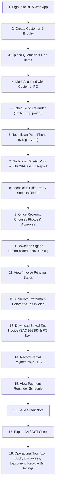

# BITA Business Management System – User Acceptance Testing (UAT) Guide

**Target Audience:** BITA Management, Technical Directors, Operations Staff, Reviewing Engineers, and Field Technicians  
**Live Production URL:** [https://bita-management-system.vercel.app](https://bita-management-system.vercel.app)  
**Technician Companion App:** [https://bita-management-system.vercel.app/field-app](https://bita-management-system.vercel.app/field-app) or `BITA-Technician.apk`  
**Document Version:** 1.0 (November 2026)  
**Data Privacy Rule:** All test data in this guide uses **100% fictional test records**. Never enter real customer, pricing, or personal data during acceptance testing.

---

## 1. Introduction & Testing Objective

This User Acceptance Testing (UAT) Guide provides BITA's management and operational team with a complete, step-by-step walkthrough to verify the core business workflow end-to-end under a single **Job ID**.

The inspection workflow connects:
$$\text{Customer Enquiry} \longrightarrow \text{Quotation} \longrightarrow \text{PO Acceptance} \longrightarrow \text{Scheduling} \longrightarrow \text{Field Inspection} \longrightarrow \text{Technical Approval} \longrightarrow \text{Tax Invoice} \longrightarrow \text{Payment \& TDS} \longrightarrow \text{Job Closure}$$

Each section provides:
1. **Where to navigate / click**
2. **What test values to enter**
3. **What expected results to verify**
4. **Acceptance checkbox `[ ]`**

---

## 2. End-to-End Workflow Map

---

## 3. Step-by-Step Acceptance Test Script

### Step 1: Sign In & Navigation Overview
- [ ] **Step 1 Completed**

1. Open your web browser (Google Chrome, Microsoft Edge, or Safari) and visit:  
   **`https://bita-management-system.vercel.app/login`**
2. Enter your authorized BITA staff credentials:
   - **Email:** `management@bita.in` (or your assigned staff email)
   - **Password:** `<your-test-password>`
3. Click **Sign in**.
4. **What you should see:**
   - You are redirected to the main dashboard (`/`).
   - The left sidebar displays the complete management menu:
     - **Main:** Home, Enquiries, Quotations, Calendar, Jobs, Reports, Invoices & payments, Finance, Log book
     - **Records & Operations:** Price list, Employees, Customers, Equipment, Settings, CA GST files, Recycle bin, Users & logins, Technician phone app
   - Quick statistics cards show counts for Active Jobs, Unassigned Jobs, In Review, Invoice Pending, and Overdue Invoices.

---

### Step 2: Create a Test Customer & Contact
- [ ] **Step 2 Completed**

1. In the sidebar, click **Customers** (`/customers`).
2. Click the **+ New Customer** button in the top right.
3. Fill in the Customer Details form using fake test data:
   - **Company Name:** `Apex Heavy Forge Pvt Ltd`
   - **GSTIN:** `29ABCDE1234F1Z5` (valid Karnataka format)
   - **State:** `Karnataka` (State code 29)
   - **Billing Address:** `Plot 98, Phase 3, Peenya Industrial Area, Bengaluru - 560058`
   - **Uses Proforma Invoice:** Check `[x]` (or leave unchecked for direct tax invoice)
   - **Dedicated Mailbox:** Leave blank (defaults to BITA main mailbox)
4. Click **Save Customer**.
5. On the customer detail page, under **Contacts**, click **+ Add Contact**:
   - **Contact Person:** `Mr. Suresh Patil`
   - **Designation:** `Quality & Inspection Manager`
   - **Mobile Number:** `+91 98450 11223`
   - **Email Address:** `suresh.patil@apex-forge-fake.in`
   - **Receives Invoices:** Check `[x]`
6. Click **Save Contact**.
7. **What you should see:**  
   The customer card displays the company profile, active GSTIN, verified state code, and the contact with the badge `Receives invoices`.

---

### Step 3: Enter an Inspection Enquiry
- [ ] **Step 3 Completed**

1. In the sidebar, click **Enquiries** (`/enquiries`).
2. Click **+ New Enquiry** (`/enquiries/new`).
3. Fill in the enquiry details:
   - **Customer:** Select `Apex Heavy Forge Pvt Ltd` from the dropdown.
   - **Contact Person:** Select `Mr. Suresh Patil`.
   - **Scope / Requirement:** `Ultrasonic Testing (UT) of Forged Turbine Shafts as per ASME Sec V Article 4`.
   - **Component / Description:** `Forged Turbine Rotor Shaft Dia 220mm x 1400mm L`.
   - **Quantity:** `4 Nos`.
   - **Test Methods:** Select `UT` (Ultrasonic Testing).
   - **Site / Location:** `Customer Works, Peenya, Bengaluru`.
   - **Urgency:** Select `Normal` or `High`.
4. Click **Create Enquiry**.
5. **What you should see:**  
   The enquiry detail page opens with status badge `Enquiry received` and a generated Enquiry reference (e.g. `ENQ/26-27/0001`). Buttons appear for **Create Quotation** and **Assign Job directly**.

---

### Step 4: Create & Upload Quotation
- [ ] **Step 4 Completed**

1. On the Enquiry page, click **Create Quotation** (or navigate to `/quotations` and click **+ New Quotation**).
2. The Quotation details page loads in `Draft` status.
3. Under **Quotation Items**, click **+ Add Item**:
   - **Select from Price List:** (Optional) Select `UT - Shaft Inspection` or enter manually:
   - **Description:** `Ultrasonic Examination of Forged Shafts (ASME Sec V)`
   - **Test Method:** `UT`
   - **Quantity:** `4`
   - **Unit:** `nos`
   - **Unit Rate (₹):** `3500.00`
4. Click **Add Item**. Total updates to `₹ 14,000.00` + GST.
5. (Optional) Under **Quotation PDF / File**, click **Choose file** and upload a PDF copy of BITA's formal quotation letter.
6. Click **Mark as Sent to Customer**.
7. **What you should see:**  
   Status changes from `Draft` to `Sent`. An action card titled **Customer Acceptance & PO** becomes active.

---

### Step 5: Mark Accepted with Customer Purchase Order (PO)
- [ ] **Step 5 Completed**

1. On the Quotation page (`/quotations/[id]`), locate the **Customer Acceptance & PO** section.
2. Fill in the received Customer Purchase Order details:
   - **PO Number:** `PO/APEX/2026/089`
   - **PO Date:** Select today's date (or yesterday's date).
   - **PO Value (₹):** `16520.00` (matches ₹ 14,000 + 18% GST).
   - **PO File (PDF or image):** (Optional) Attach a sample PDF/image file.
   - **Create linked job immediately on acceptance:** Keep checked `[x]`.
3. Click **Accepted by customer**.
4. **What you should see:**  
   - Quotation status updates to `Accepted`.
   - A new Job ID is automatically created in financial-year format (e.g. `BITA/26-27/0001`).
   - A direct link to the new Job page appears on screen.

---

### Step 6: Schedule Job on the Calendar (Technician + Equipment Assignment)
- [ ] **Step 6 Completed**

1. In the sidebar, click **Calendar** (`/calendar`).
2. The interactive schedule grid opens in **Week View** (toggleable to **Month View**).
3. Click the **+ Schedule Job** button in the top right.
4. In the Schedule Modal:
   - **Job:** Select `BITA/26-27/0001 (Apex Heavy Forge Pvt Ltd)`.
   - **Technician:** Select an active technician (e.g. `Ramesh Kumar` or your test technician).
   - **Date Range:** Select **Start Date** (e.g. today) and **End Date** (e.g. tomorrow for a 2-day assignment).
   - **Equipment:** Select an available UT Flaw Detector (e.g. `EEC FD-400, Serial: FD-2024-001`).
5. **Notice the real-time conflict detector:**
   - If the equipment or technician is already booked on those dates, an amber warning banner highlights the conflict.
6. Click **Schedule & Notify**.
7. **What you should see:**  
   - The modal closes cleanly.
   - The technician's row on the calendar shows a solid badge spanning the selected dates with Job ID `BITA/26-27/0001` and equipment tag.
   - The job's status updates from `awaiting_approval` to `scheduled`.

---

### Step 7: Technician Phone Pairing (Android APK or Mobile Browser)
- [ ] **Step 7 Completed**

1. On your office desktop, open **Employees** (`/employees`).
2. Click on the assigned technician's name.
3. Locate the **Linked Phones & Devices** card and click **Link a phone**.
4. A large, high-visibility **6-digit pairing code** appears on screen (e.g. `834 912`, valid for 15 minutes).
5. On your mobile phone (or in a new private browser tab):
   - Open **`https://bita-management-system.vercel.app/field-app`** (or open `BITA-Technician.apk`).
6. Enter the 6-digit code and tap **Link this phone**.
7. **What you should see:**  
   - The phone authenticates instantly without requiring passwords or emails.
   - The screen transitions to **My Jobs**.
   - Job `BITA/26-27/0001` for `Apex Heavy Forge Pvt Ltd` appears in the technician's queue.
   - On the office desktop, refreshing the page shows the device status as `Active` with device model and last seen timestamp.

---

### Step 8: Technician Starts Work & Fills 29-Field UT Report
- [ ] **Step 8 Completed**

1. On the mobile phone (`/field-app`):
2. Tap on Job `BITA/26-27/0001`.
3. Tap the green button **Start Work**.
   - Notice the status updates to `In Progress` and the start timestamp is captured.
4. Tap **Enter UT inspection report** (Ultrasonic Testing).
5. Fill in the **29 standard BITA UT Report fields** (verified from BITA's official format):
   - **Header Details:**
     - Standard / Code: `ASME Sec V Article 4`
     - Acceptance Criteria: `ASME Sec VIII Div 1 Appendix 12`
     - Surface Condition: `Machined`
     - Surface Temperature: `32°C`
     - Stage of Examination: `Final Machined Condition`
   - **Equipment & Probe Settings:**
     - Equipment / Flaw Detector: `EEC FD-400 (Sr No: FD-2024-001)`
     - Calibration Due: `31/03/2027`
     - Calibration Method: `IIW V1 Block Time Base Calibration`
     - Reference Block(s): `IIW V1 Block, Step Wedge`
     - Probe Type: `Normal Beam Dual Crystal`
     - Probe Frequency: `2.0 MHz`
     - Probe Size: `Dia 20mm`
     - Couplant: `Grease / SAE 40 Engine Oil`
     - Scanning Level: `Reference Level + 6 dB`
     - Cable Type & Length: `BNC-BNC 2 Meters`
   - **Component Inspection Table:**
     - Description: `Forged Turbine Rotor Shaft`
     - Identification / Serial No: `SHAFT-2026-001`
     - Size: `Dia 220mm x 1400mm`
     - Quantity: `4`
     - Unit: `Nos`
     - Observations: `No recordable planar or volumetric discontinuities observed. DAC attenuation within permissible limits.`
     - Result: Select `Acceptable`
6. Under **Inspection Photographs**, tap **Take / Upload Photo** and attach 1–2 test images (e.g. photo of component serial marking and ultrasonic flaw detector A-scan screen).
7. Tap **Save Draft**. Notice the confirmation message "Draft saved locally".

---

### Step 9: Technician Submits Report & Tests One-Time Pre-Approval Edit
- [ ] **Step 9 Completed**

1. On the mobile form, tap **Submit Report for Technical Review**.
2. **What you should see:**  
   - If any mandatory field was skipped, the system displays an amber notice highlighting the exact missing field.
   - Once all mandatory fields are present, the report submits successfully.
   - The status badge changes to **Submitted / In Review**.
3. **Verify the pre-approval correction feature:**
   - While the report is waiting for technical review, tap **Edit submitted report**.
   - Modify the observation notes (e.g. change `"DAC attenuation within permissible limits"` to `"100% volumetric examination completed; DAC attenuation within permissible limits"`).
   - Tap **Resubmit Report**.
4. **What you should see:**  
   - The revision is accepted cleanly.
   - The edit history is logged in `inspection_edits` with previous vs new values.

---

### Step 10: Technical Office Review, Photo Selection & Technical Approval
- [ ] **Step 10 Completed**

1. Back on the office desktop, click **Reports** (`/review`) in the sidebar.
2. The review queue lists the submitted report for Job `BITA/26-27/0001` with status badge `In Review`.
3. Click on the report row to open the Technical Review screen (`/review/[reportId]`).
4. **Verify the Review Screen components:**
   - **Side-by-side inspection data:** All 29 UT fields and repeating component rows are clearly laid out in BITA's official layout.
   - **Correction History:** Notice the audit log showing the technician's pre-approval edit with exact timestamps and diffs.
   - **Photo Selection:** Each uploaded photograph has a checkbox **Include in final report**.
     - Check `[x]` for Photo 1 (e.g. component serial plate).
     - Uncheck `[ ]` for Photo 2 (to verify only selected photos appear in the final printed report).
5. At the bottom, click **Approve Report**.
6. **What you should see:**  
   - A success banner confirms report approval.
   - The status updates to **Approved**.
   - BITA digital seal and signatory approval blocks are applied.

---

### Step 11: Download Technical Inspection Report (Word .docx & PDF)
- [ ] **Step 11 Completed**

1. On the approved report page (`/review/[reportId]`), locate the export buttons:
   - Click **Download Word Report (.docx)**
   - Click **Download PDF Report (.pdf)**
2. Open the downloaded `.docx` and `.pdf` files:
3. **Verify Report Quality & Layout:**
   - BITA header with Company Name, contact, and NDT Agency credentials.
   - Report No. matches BITA format (e.g. `BITA/UT/26-27/0001`).
   - All 29 UT fields render in BITA's exact boxed grid.
   - The component row renders identification serial numbers and result `ACCEPTABLE`.
   - Only the photo checked in Step 10 appears in the document.
   - Technical Reviewer signature and approval stamp are present at the bottom.

---

### Step 12: Verify "Invoice Pending" Queue & Prepare Proforma Invoice
- [ ] **Step 12 Completed**

1. In the sidebar, click **Reports** (`/review`).
2. Notice the filter tab **Invoice Pending**:
   - Job `BITA/26-27/0001` is clearly listed with badge `Invoice Pending`.
3. Click on the approved report to open its detail view.
4. Click **Prepare invoice** (or **Generate invoice**).
5. The invoice creation screen opens at `/invoices/[id]`:
   - Under **Invoice Series / Type**, select **Proforma Invoice** (or keep direct Tax Invoice).
   - **Invoice Date:** Today's date.
   - **Due Date:** Automatically calculated per customer payment terms (30 days).
6. Under **Line Items**, verify items are auto-populated from the approved report and accepted quotation:
   - Description: `Ultrasonic Examination of Forged Shafts (ASME Sec V)`
   - SAC Code: `998393` (BITA's official inspection SAC code)
   - Quantity: `4`, Rate: `₹ 3500.00`, Subtotal: `₹ 14,000.00`
   - CGST (9%): `₹ 1,260.00`
   - SGST (9%): `₹ 1,260.00`
   - Total Amount: `₹ 16,520.00`
7. Click **Issue Proforma Invoice** (or **Save Draft**).
8. **What you should see:**  
   The Proforma invoice is created with number `BITA/26-27/PI-0001` and status badge `Issued (Proforma)`.

---

### Step 13: Convert Proforma to Boxed Tax Invoice & Download (.docx / .pdf)
- [ ] **Step 13 Completed**

1. On the Proforma Invoice detail page (`/invoices/[id]`), click the action button:  
   **Convert to Tax Invoice**.
2. A confirmation prompt explains that a permanent Tax Invoice number will be assigned.
3. Click **Confirm Conversion**.
4. **What you should see:**  
   - The invoice number updates to BITA's official tax sequence (e.g. `BITA/26-27/INV-0001` or continuation series `5388`).
   - The status updates to `Issued (Tax Invoice)`.
5. Click **Download Word Invoice (.docx)** and **Download PDF Invoice (.pdf)**.
6. **Verify the Boxed Invoice Layout:**
   - **Top-Right Box:** Displays Customer P.O. Number (`PO/APEX/2026/089`) and P.O. Date (matching BITA's physical boxed format).
   - **Left Box:** Displays BITA Company Profile, GSTIN, PAN, and Bank Account details.
   - **Middle Grid:** Displays SAC Code `998393`, description, rate, taxable value, CGST 9%, and SGST 9%.
   - **Bottom:** Shows total in words (`Sixteen Thousand Five Hundred Twenty Rupees Only`) and authorized signatory block.

---

### Step 14: Record Partial Payment with TDS Deduction
- [ ] **Step 14 Completed**

1. On the Tax Invoice page (`/invoices/[id]`), scroll to the **Record Payment** card.
2. Enter the payment details reflecting a typical BITA corporate transaction with 2% TDS:
   - **Payment Date:** Today's date.
   - **Amount Received in Bank (₹):** `16,190.00`
   - **TDS Deducted under Sec 194C / 194J (₹):** `330.00` (2% of taxable value ₹ 16,500)
   - **Payment Mode:** `NEFT / RTGS`
   - **Reference / UTR Number:** `UTR/SBIN202611120098`
   - **Remarks:** `Part payment received via SBI Corporate NetBanking; TDS certificate awaited.`
3. Click **Save Payment**.
4. **What you should see:**  
   - The total credit is calculated as `₹ 16,190.00 (Bank) + ₹ 330.00 (TDS) = ₹ 16,520.00`.
   - Outstanding Balance decreases to `₹ 0.00`.
   - Status badge changes from `Issued` to **Paid**.

---

### Step 15: View Automated Payment Reminder Schedule
- [ ] **Step 15 Completed**

1. In the sidebar, click **Settings** (`/settings`).
2. Scroll to **Reminder Timings**:
   - **Before Due Reminder:** `2 days before due date` (`before_due`)
   - **Due Date Reminder:** `On due date` (`on_due`)
   - **Grace Period:** `No reminders for 1–4 days after due date`
   - **Overdue Frequency:** `Daily from the 5th day overdue` (`overdue`)
3. Open a browser tab to the administrative reminder preview route:  
   **`https://bita-management-system.vercel.app/api/reminders/plan`**
4. **What you should see:**  
   - For paid invoices (`balance = 0`), reminders are automatically paused.
   - For unpaid invoices, planned reminder email payloads are computed with the customer's dedicated contact (`receives_invoices = true`) and customer-specific mailbox.

---

### Step 16: Issue a Credit Note
- [ ] **Step 16 Completed**

1. Navigate to **Invoices** (`/invoices`) and click on any issued tax invoice.
2. In the actions menu, click **Issue Credit Note**.
3. Fill in the credit note modal:
   - **Reason:** Select `Price Correction` or `Discounts / Rate Difference`.
   - **Credit Amount (₹):** `1000.00`
   - **GST Adjustment:** Automatically splits `₹ 90.00 CGST + ₹ 90.00 SGST`.
   - **Remarks:** `Agreed discount for bulk shaft inspection batch.`
4. Click **Issue Credit Note**.
5. **What you should see:**  
   - A sequential Credit Note number is generated (e.g. `BITA/26-27/CN-0001`).
   - The invoice balance adjusts automatically.
   - The credit note is linked to the original tax invoice and appears in the GST export ledger.

---

### Step 17: CA / GST Export (GSTR-1 Format)
- [ ] **Step 17 Completed**

1. In the sidebar, click **Invoices & payments** (`/invoices`) or **CA GST files** (`/invoices/export`).
2. Click **Export for CA / GST** in the top right.
3. In the export dialog:
   - **Financial Year:** Select `2026-2027`
   - **Month:** Select `November` (or `All Months`)
   - **Format:** Choose **CSV** or **Excel (.xlsx)**
4. Click **Download Export**.
5. Open the exported spreadsheet:
6. **Verify CA Columns:**
   - `GSTIN/UIN of Recipient`
   - `Receiver Name`
   - `Invoice Number`
   - `Invoice Date`
   - `Invoice Value`
   - `Place Of Supply (POS)`
   - `Reverse Charge`
   - `Applicable % of Tax Rate (18%)`
   - `Invoice Type` (Regular B2B / Proforma / Credit Note)
   - `E-Commerce GSTIN`
   - `Rate`, `Taxable Value`, `Cess Amount`
   - `TDS Deducted Amount` and `TDS Certificate Status`

---

### Step 18: Operational Registers Tour
- [ ] **Step 18 Completed**

#### A. Log Book / Job Expenses (`/log-book`)
1. Click **Log Book** in the sidebar.
2. Click **+ Add Expense**:
   - **Date:** Today.
   - **Job ID:** Select `BITA/26-27/0001`.
   - **Category:** Select `Travel / Fuel` (or `Lodging`, `Food`, `Consumables`).
   - **Amount (₹):** `650.00`.
   - **Paid By:** Select technician or office staff.
   - **Remarks:** `Fuel reimbursement for site inspection visit to Peenya.`
3. Click **Save Expense**. Total site expenses update immediately.

#### B. Employee Register & Month View (`/employees`)
1. Click **Employees** in the sidebar.
2. Switch to the **Monthly Attendance View**:
   - Technicians are listed with calendar cells for each day of the current month.
   - Days with job assignments display the green Job ID badge.
   - Public holidays (configured in Settings) and approved leave days are clearly marked.
   - Idle days are highlighted.
   - **Note:** Technician salary data is visible **only** to management accounts.

#### C. Equipment Register & Delivery Challan (`/equipment`)
1. Click **Equipment** in the sidebar.
2. Click on the UT Flaw Detector (`EEC FD-400`).
3. Click **Record Movement / Delivery Challan**:
   - **Destination:** `Apex Heavy Forge Pvt Ltd (Peenya Works)`
   - **Movement Date:** Today.
   - **Carried By:** Select assigned technician.
   - **Purpose:** `Site Inspection Job BITA/26-27/0001`.
4. Click **Create Challan**. A printable Equipment Delivery Challan is generated.

#### D. Recycle Bin Soft-Delete & Restore (`/recycle-bin`)
1. In **Equipment** (`/equipment`), select a test accessory or spare yoke.
2. Click **Delete** and confirm the dialog.
3. Navigate to **Recycle Bin** (`/recycle-bin`).
4. Locate the deleted item in the list and click **Restore**.
5. Return to `/equipment` and verify the item is immediately restored to active inventory.

#### E. Management Settings (`/settings`)
1. Click **Settings** in the sidebar (Management access only).
2. Inspect the configured modules:
   - **Company Profile:** Official BITA address, PAN, GSTIN, default SAC `998393`, and bank details.
   - **Invoice Numbering:** Starting sequences for Tax Invoices, Proformas, and Credit Notes.
   - **Public Holidays:** Calendar of company non-working days.
   - **Role Permissions Matrix:** Access control matrix for `management`, `office`, `reviewer`, and `technician`.
   - **Telegram Executive Bot:** Pairing status, webhook registration, and instant test digest trigger.

---

## 4. One-Page Feedback & Sign-Off Sheet

Please print or copy this feedback table to record test observations during your acceptance session:

| Step # | Verification Step | Tested By | Date | Result (Pass / Fail) | Observations / Notes |
| :---: | :--- | :--- | :--- | :---: | :--- |
| **1** | Web App Sign In & Dashboard Navigation | | | `[ ] Pass  [ ] Fail` | |
| **2** | Create Customer & Contact (`Apex Heavy Forge`) | | | `[ ] Pass  [ ] Fail` | |
| **3** | Create Inspection Enquiry | | | `[ ] Pass  [ ] Fail` | |
| **4** | Create Quotation & Add Line Items | | | `[ ] Pass  [ ] Fail` | |
| **5** | Customer Acceptance with Purchase Order (PO) | | | `[ ] Pass  [ ] Fail` | |
| **6** | Calendar Assignment & Equipment Conflict Check | | | `[ ] Pass  [ ] Fail` | |
| **7** | Technician Phone Pairing via 6-Digit Code | | | `[ ] Pass  [ ] Fail` | |
| **8** | Technician Starts Work & Fills 29-Field UT Form | | | `[ ] Pass  [ ] Fail` | |
| **9** | Technician Photo Upload & Pre-Approval Edit | | | `[ ] Pass  [ ] Fail` | |
| **10** | Technical Review, Photo Selection & Approval | | | `[ ] Pass  [ ] Fail` | |
| **11** | Download Inspection Report (Word .docx & PDF) | | | `[ ] Pass  [ ] Fail` | |
| **12** | Invoice Pending Queue & Proforma Generation | | | `[ ] Pass  [ ] Fail` | |
| **13** | Convert Proforma to Boxed Tax Invoice (SAC 998393) | | | `[ ] Pass  [ ] Fail` | |
| **14** | Record Partial Payment & TDS Deduction | | | `[ ] Pass  [ ] Fail` | |
| **15** | View Automated Payment Reminder Plan | | | `[ ] Pass  [ ] Fail` | |
| **16** | Issue Credit Note & Balance Adjustment | | | `[ ] Pass  [ ] Fail` | |
| **17** | CA / GST Export Generation | | | `[ ] Pass  [ ] Fail` | |
| **18** | Log Book, Employee Register & Equipment Challan | | | `[ ] Pass  [ ] Fail` | |

**Overall Acceptance Sign-Off:**

- **Testing Status:** `[ ] Approved for Production  [ ] Approved with Minor Changes  [ ] Requires Rework`
- **Lead Manager Name:** __________________________________
- **Signature:** ___________________________________________
- **Date:** ________________________

---

## 5. Known Limitations & Ongoing Enhancements

The following ongoing enhancements are scheduled for the upcoming production update:

1. **Executive Financial Analytics:**  
   Receivables ageing breakdown brackets (0–30, 31–60, 61–90, 90+ days) and customer-wise revenue vs expense comparison in the dedicated **Finance** module.
2. **Physical Notebook Register Export:**  
   An export matching BITA's historical inspection notebook format (date, customer, component, technician, report number, invoice number, remarks) on `/jobs`.
3. **Automatic Job Closure on Zero Balance:**  
   Once all tax invoices for a job are fully settled (bank payment + TDS + credit notes) and reports are sent, the job automatically transitions to `closed`.
4. **Custom Company Logo & Signature Uploads:**  
   Reports and invoices currently render clean SVG placeholder logos and digital approval blocks. Dedicated image upload fields for company logo, physical stamp/seal, and individual engineer signatures in **Settings → Company Profile**.
5. **AI Email Enquiry Paste-Assist:**  
   The enquiry extraction logic (`lib/ai/extract-enquiry.ts`) is fully tested and operational; a convenient "Paste email here" prefill box on `/enquiries/new` allows rapid enquiry entry.
6. **Soft-Delete on Enquiries, Quotations, and Jobs:**  
   Confirmation dialogs and permission guards for deleting Enquiries, Quotations, and Jobs with full audit logging and Recycle Bin restoration.
7. **Custom Report Template Editor:**  
   The field API dynamically delivers the full 29-field UT report and MT/DPT schemas. An editor in **Settings** allows customizing template fields for ad-hoc test methods.

---

## 6. Pre-Go-Live Supplier & Operational Checklist

Before transitioning from acceptance testing to daily commercial operations, BITA management must complete the following items:

| # | Item | Owner | Description / Action Required |
| :-: | :--- | :--- | :--- |
| **1** | **Official Company Profile** | BITA Management | In **Settings → Company Profile (`/settings`)**, enter BITA's official PAN, GSTIN, Default SAC Code (`998393`), and official Bank Account details (Account Number, Bank Name, IFSC). |
| **2** | **Invoice Sequence Configuration** | BITA Accounts | In **Settings → Invoice Numbering**, verify the next Tax Invoice number (e.g. `5388`), Proforma number, and Credit Note number match BITA's current accounting sequence. |
| **3** | **Staff Logins & Passwords** | BITA Management | Under **Settings → Users (`/settings/users`)**, create logins for the two managing partners, reviewing engineers, and office staff. |
| **4** | **Supabase Auth Hardening** | IT / Admin | In the Supabase Dashboard, verify: (a) Public Sign-Up is turned **OFF**; (b) Leaked-Password Protection is turned **ON**. |
| **5** | **SMTP Email Configuration** | IT / Admin | Provide outgoing SMTP credentials for BITA's official email domain (for password resets and automated customer payment reminders). |
| **6** | **Telegram Executive Bot** | BITA Management | Create an official bot with `@BotFather` under BITA's Telegram account, provide the bot token, and register the webhook under **Settings → Telegram Executive Bot**. |
| **7** | **Technician Phone Setup** | BITA Operations | Install `BITA-Technician.apk` (or bookmark `/field-app`) on each field technician's Android phone and pair using 6-digit codes. |
| **8** | **Hosting Tier Upgrade** | Naveen / BITA | Upgrade Vercel from Hobby to **Vercel Pro** (or host on a dedicated Hostinger VPS) to comply with commercial usage terms. |
